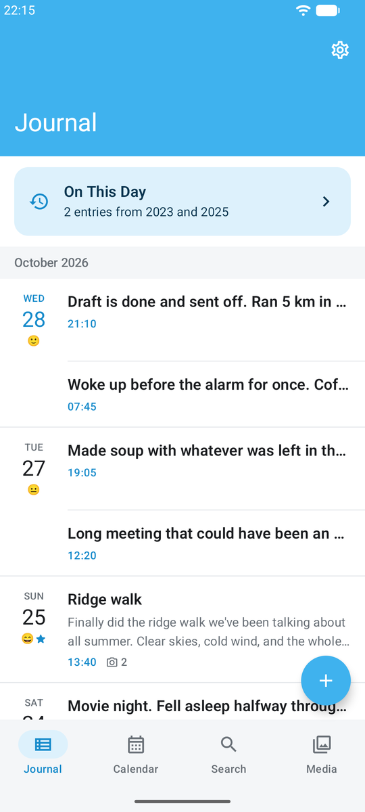
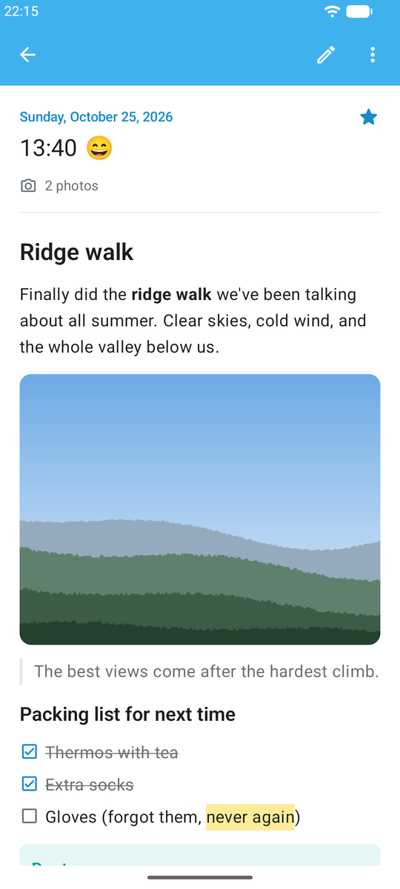
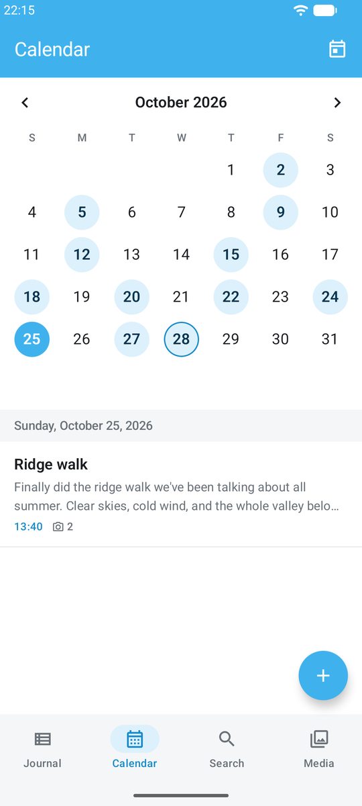
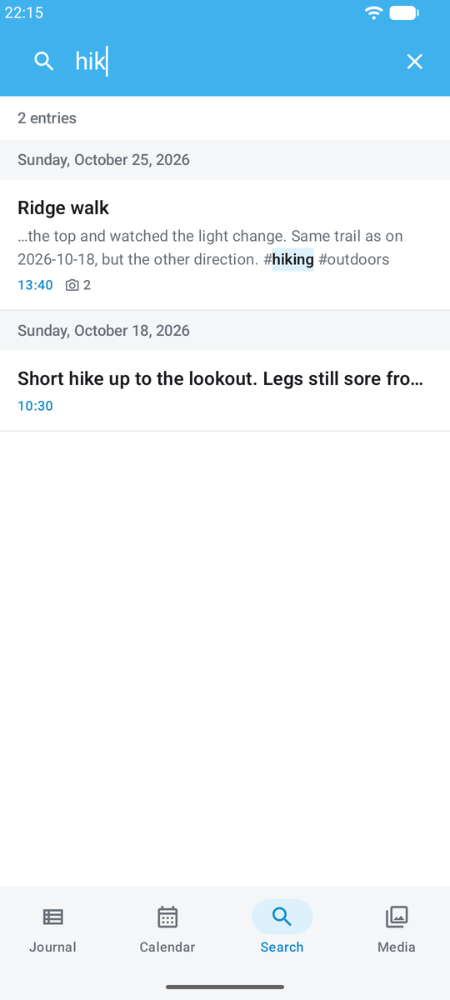
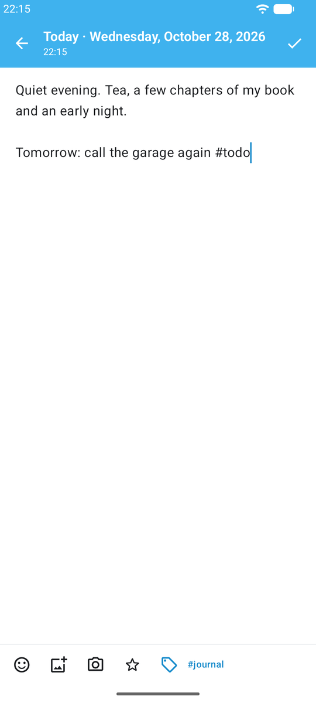

# Journal

A Day One-style journaling app for Android that reads and writes plain Markdown directly in an
existing [Obsidian](https://obsidian.md) vault. There is no database of record and no account:
your daily notes are the data, and anything written in the app looks right in Obsidian (and the
other way round).

<p>
  
  
  
  
  
</p>

<sub>Timeline, entry, calendar, search and editor, shown with a demo vault.</sub>

## Features

- **Timeline** of all entries, newest first, with an *On This Day* banner for earlier years.
- **Calendar** with markers on days that have a note; write backdated entries from any day.
- **Editor** for Markdown entries with tags, mood and photos (gallery or camera).
- **Formatted entry view** like Obsidian's reading view: wikilinks, embeds, callouts, tasks,
  tables, `==highlights==` and `#tags`.
- **Media grid** of every photo and video across the journal.
- **Search** with words, `"phrases"` and `#tags` (case- and accent-insensitive).
- **Quick capture**: share text, links or photos from other apps, a home-screen widget and app
  shortcuts.
- **App lock** with fingerprint, face or the device PIN; quick capture still works while locked.
- **Daily reminder** at a time you choose, only on days you haven't written anything yet.

The app makes no network calls and doesn't record location. Syncing between devices is left to
whatever already syncs the vault (e.g. Syncthing).

## How notes are stored

The app works with the layout the vault already has, one note per day:

```
<vault>/
  Journal/            (configurable)
    YYYY/
      YYYY-MM-DD.md
```

A daily note holds any number of entries. Day-level metadata is frontmatter; each entry written
by the app is a `## HH:mm` section, with optional per-entry fields as Dataview inline fields:

```markdown
---
date: 2026-10-23
tags: [journal, family]
mood: 4
---

## 08:42
Morning entry, plain Markdown.

## 20:11
mood:: 5

Evening entry.

![[2026-10-23-2011-1.jpg]]
```

Everything is optional: a note written in Obsidian with no frontmatter or headings shows up as one
entry for that day. The app only touches the section it edits, keeps unknown frontmatter keys and
text it doesn't recognise byte for byte, and writes files atomically. If a file changed on disk
(through sync or Obsidian) while an entry was open, new entries are merged in and conflicting edits
ask before overwriting. Photos go into the attachment folder set in Obsidian
(`.obsidian/app.json`), named `YYYY-MM-DD-HHmm-N.jpg`.

## Building

Requirements: JDK 17 or newer and the Android SDK (compileSdk 37). The app runs on Android 8.0
(API 26) and up.

```sh
./gradlew :core:test          # parser/writer and other unit tests
./gradlew :app:assembleDebug  # builds app/build/outputs/apk/debug/app-debug.apk
```

On first launch, pick the vault's root folder (the one containing `.obsidian`) and the journal
folder inside it.

## Project structure

- `core/`: pure Kotlin, no Android. Parsing and writing daily notes, timeline model, Markdown
  rendering model, search syntax, rescan planning. Unit tests run against a small fixture vault
  in `core/src/test/resources/fixtures`.
- `app/`: the Android app. Kotlin, Jetpack Compose and Material 3; vault access through the
  Storage Access Framework; a Room index (a rebuildable cache, never the source of truth) kept up
  to date by a background rescan with WorkManager.

See [`CLAUDE.md`](CLAUDE.md) for the detailed design notes.

## License

[MIT](LICENSE)
